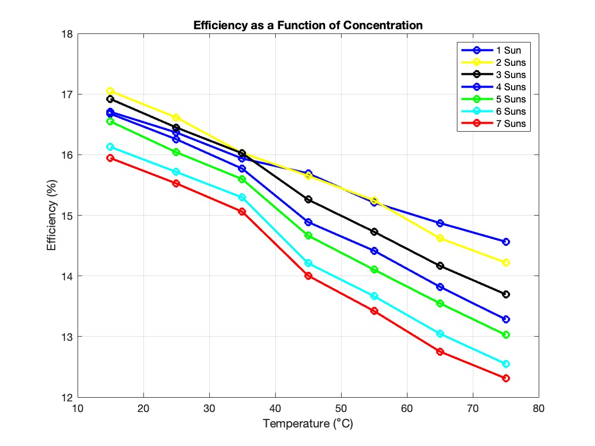
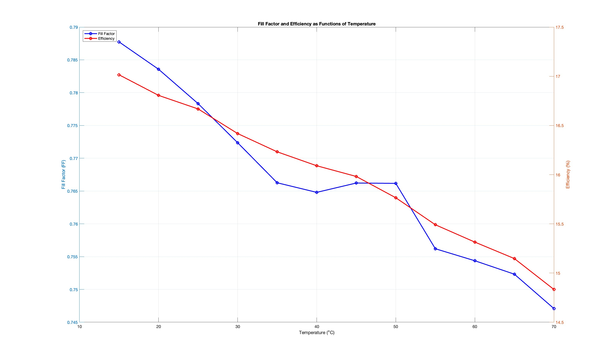
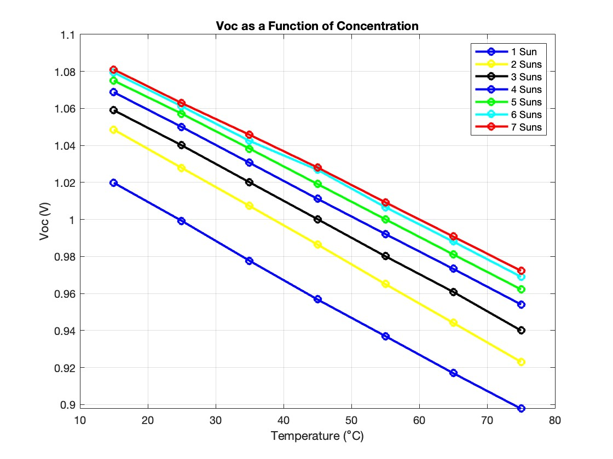

# Temperature and Concentration Dependence of GaAs Solar Cells

**How much efficiency does a GaAs concentrator cell lose as it heats up, and does concentrating
the light make it worse?** Analysis code for I-V and quantum-efficiency measurements of GaAs
solar cells from 15 to 75 °C and 1 to 7 suns.

*Research internship (IAESTE), Sugiyama Laboratory, RCAST, The University of Tokyo, Summer 2023. MATLAB.*

## Results

**Thermal study** (one 0.25 cm² GaAs cell, 1 sun xenon source, 15–70 °C in 5 °C steps):

| | 15 °C | 70 °C | Linear trend |
|---|---|---|---|
| Efficiency | 17.0% | 14.8% | −0.038 points/°C (**~0.4 points per 10 °C**, −0.23%/°C relative to 25 °C) |
| Open-circuit voltage | 1.020 V | 0.908 V | −2.05 mV/°C |
| Short-circuit current density | 21.2 mA/cm² | 21.9 mA/cm² | +0.014 mA/cm²/°C |
| Fill factor | 0.79 | 0.75 | |

- Voc loss dominates. The small Jsc gain matches the narrowing GaAs bandgap
  (about −0.48 meV/K from a Bose-Einstein bandgap model), which lets the cell absorb slightly
  longer wavelengths.
- **Under concentration** (1–7 suns, 15–75 °C), efficiency falls with temperature at every
  concentration. The drop is steeper at higher concentration: about 2 points at 1 sun and
  3.6 points at 7 suns over 60 °C. At a fixed temperature, more suns also cost some efficiency,
  as fill factor drops.
- Concentrator designs therefore need active thermal management. Temperature, not
  concentration level, is the larger lever.

| Fill factor and efficiency vs. temperature | Voc vs. temperature, 1–7 suns |
|---|---|
|  |  |

## What the code does

| File | Purpose |
|---|---|
| [`plotThermal.m`](src/plotThermal.m) | Thermal study: extracts Voc, Jsc, FF and efficiency at each temperature, fits linear temperature coefficients, plots I-V at 15 vs. 70 °C, and computes the GaAs bandgap vs. temperature |
| [`plotTh_Conc.m`](src/plotTh_Conc.m) | Concentration study: same parameters at 1–7 suns. Efficiency is normalized using the measured Jsc ratio as the effective concentration, because the tester assumes 1-sun input. |
| [`IVThermal.m`](src/IVThermal.m), [`IVTh.m`](src/IVTh.m) | Read one solar-simulator data file and return the I-V curve and summary parameters |
| [`plotIV.m`](src/plotIV.m), [`TableAverage.m`](src/TableAverage.m), [`variables.m`](src/variables.m), [`varstd.m`](src/varstd.m), [`plotstd.m`](src/plotstd.m) | Sample comparison: average I-V curves and parameters over repeated measurements of seven samples, with standard deviations |
| [`SResponse.m`](src/SResponse.m), [`EQEAverage.m`](src/EQEAverage.m), [`Jsc.m`](src/Jsc.m), [`plotEQE.m`](src/plotEQE.m), [`plotJsc.m`](src/plotJsc.m) | Spectral response to external quantum efficiency, and Jsc predicted by integrating EQE against the AM1.5G spectrum |

[`results/gaas_bandgap_vs_temperature.csv`](results/gaas_bandgap_vs_temperature.csv) holds the computed bandgap from 288 to 343 K.

## Data

The measurements belong to the Sugiyama Laboratory and are **not included**.
[`data/README.md`](data/README.md) describes the file layout the scripts expect, so the code can be
pointed at equivalent measurements. MATLAB R2020b or later, no toolboxes.

## Author

**Jose Ernesto Sandoval Hernandez**, MSc Mechanical Engineering, Purdue University.

[LinkedIn](https://www.linkedin.com/in/jsahe) · [Google Scholar](https://scholar.google.com/citations?user=cL2oeXIAAAAJ&hl=en)
